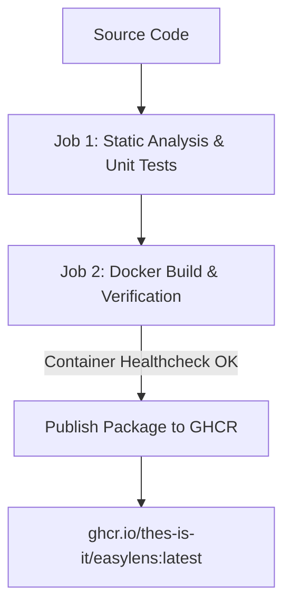

# EasyLens Docker & Containerization Guide

This document explains how the EasyLens container image is built, tested, and published automatically as a Docker package to the GitHub Container Registry (GHCR).

---

### 01 — ARCHITECTURE OVERVIEW

The container setup uses an NGINX production server:



#### Key Components

- `Dockerfile`: Multi-stage build (`asset-stage` on Alpine Linux + hardened `production-stage` on `nginx:1.25-alpine`) with asset verification, non-root least-privilege permissions, and dual-stack healthcheck.
- `nginx.conf`: NGINX dual-stack (`0.0.0.0:80` and `[::]:80`) server configuration with Gzip compression and security headers (`DENY`, `nosniff`, `XSS-Protection`).
- `docker-compose.yml`: Local container orchestration with automated healthcheck probe.
- `scripts/test_docker.sh`: Automated test suite verifying all 3 Docker deployment modes.
- `.dockerignore`: Excludes build caches, native OS folders, and large binary models (`model.bin`).

---

### 02 — QUICK START: RUNNING LOCALLY WITH DOCKER

#### Prerequisites

> - `Docker Desktop` installed and running.

#### Using Docker Compose (Recommended)

##### Standard Local Launch
To build and launch the containerized application in detached mode:

```bash
docker compose up --build -d
```

Once started, navigate to:
`http://localhost:8080`

To stop the container:
```bash
docker compose down
```

---

### 02.1 — FRESH INSTALLATION & VERIFICATION PROTOCOL

To verify a clean deployment from an uninitialized environment without pre-existing container state:

1. **Step 1: Verify Clean Environment (Nothing Running)**
   Ensure no previous instance or port conflict exists:
   ```bash
   docker compose down
   docker ps | grep easylens
   ```
   *(Expected output: No EasyLens container running)*

2. **Step 2: Build & Start Container from Scratch**
   ```bash
   docker compose up --build -d
   ```
   *(This builds the NGINX image and launches `easylens_mobile_server` on port 8080)*

3. **Step 3: Verify Status & Health Check**
   ```bash
   docker compose ps
   curl -I http://localhost:8080/
   ```
   *(Expected output: Status `Up (healthy)`, HTTP `200 OK`)*

4. **Step 4: Demo the Web Portal**
   Open your browser to:
   **`http://localhost:8080`**
   Showcase the live EasyLens Web Portal, APK download link, responsive layout, and headers.

5. **Step 5: Clean Teardown**
   When the demo is concluded, cleanly stop and remove the container:
   ```bash
   docker compose down
   ```

---

### 02.2 — AUTOMATED VERIFICATION SUITE (`scripts/test_docker.sh`)

To execute an automated test across all Docker deployment options (Docker Compose, standalone CLI, and GHCR package):

```bash
chmod +x scripts/test_docker.sh
./scripts/test_docker.sh
```

This script:
1. Validates Docker daemon responsiveness.
2. Builds and starts `docker-compose.yml`, waits for the container healthcheck to transition to `healthy`, tests `http://localhost:8080/`, and verifies clean teardown.
3. Compiles `easylens:latest` using the multi-stage `Dockerfile`, executes `easylens_app`, verifies HTTP 200, and cleans up.
4. Pulls the GHCR pre-built image, launches `easylens_live`, verifies HTTP 200, and cleanly tears down.

---

#### Using Docker CLI Manually

##### Build the Docker Image
```bash
docker build -t easylens:latest .
```

##### Run the Container
```bash
docker run -d \
  --name easylens_app \
  -p 8080:80 \
  --restart always \
  easylens:latest
```

##### Test Container Health
```bash
curl -f http://localhost:8080/
```

---

### 03 — PULLING PRE-BUILT PACKAGE IMAGE FROM GITHUB PACKAGES (GHCR)

On every push to the `main` branch, GitHub Actions compiles and publishes the official Docker package image directly to GitHub Container Registry (GHCR). You can pull and run the package without building locally:

```bash
# Pull the latest Docker package
docker pull ghcr.io/thes-is-it/easylens:latest

# Run the containerized app
docker run -d \
  --name easylens_live \
  -p 8080:80 \
  --restart always \
  ghcr.io/thes-is-it/easylens:latest
```

---

### 04 — AUTOMATED CI/CD WORKFLOW (`.github/workflows/ci_cd.yml`)

1. **`analyze_and_test`**:
   - Runs static code analysis (`flutter analyze --no-fatal-warnings --no-fatal-infos`).
   - Executes all unit tests (`flutter test`).
2. **`docker_build_and_publish`**:
   - Builds Docker image and verifies container health (`curl http://localhost:8080/`).
   - Publishes Docker package to GitHub Packages (`ghcr.io/thes-is-it/easylens:latest`).

---

### 05 — LICENSE & MAINTAINERS

Maintained by the Thes-IS-IT Research Team (Holy Angel University):
- **Graciella Mhervie D. Jimenez**
- **Jian Kalel D. Marquez**
- **Arron Kian M. Parejas**
- **Jenica Sarah B. Tongol**

EasyLens is licensed under a Modified MIT License with Academic Thesis Conditions. See [`LICENSE.md`](LICENSE.md) for full terms.
